  

<h2 align="center">Hi, I'm Ayush 👋</h2>

  <b>DevOps Engineer L2 @ SegueIT</b> · Noida, India 
  I turn a <code>git push</code> into a tested, versioned container running in production, 
  and make sure the team hears about it the moment something stops responding.

  
  
  

---

### 🛠️ What I do

- 🚀 **Ship code safely:** CI/CD with GitHub Actions (self-hosted runners), images tagged with the Git commit SHA, deployment locks, `/health` checks and blue/green releases with rollback.
- ☁️ **Run cloud infrastructure:** AWS (EC2, ECR, ECS, Lightsail, Amplify, RDS, S3, CloudFront) and Azure (VMs, ACR, App Service). Client accounts isolated in AWS Organizations, one OU per client.
- 📈 **Watch production:** Prometheus, Grafana, Loki and Alertmanager on a separate monitoring server, plus uptime alerts to a Zoho Cliq channel. Zabbix in progress.
- 🔐 **Keep it secure and recoverable:** EC2 IAM instance roles instead of long-lived keys, NGINX hardening (TLS, rate limiting, security headers), RDS and EC2 backups with AWS Backup.

### 🧰 Tech stack

  

### 📦 Work I've shipped

Client names are generalised; this work runs in production and the code is private.

| Project | What I built | Stack |
|---|---|---|
| **Pharmacy e-commerce** | Commit → ECR → EC2 release pipeline with SHA-tagged images, IAM instance role and blue/green releases behind NGINX | GitHub Actions · Docker · ECR · EC2 · RDS · S3 · CloudFront |
| **Visitor & staff management** | Locked deploys on a self-hosted runner, WebSocket-ready NGINX, monitoring stack on its own server | GitHub Actions · Docker · NGINX · Prometheus · Grafana · Loki |
| **Segue Monitor** | White-labelled Uptime Kuma: HTTP and keyword checks with alerts to Zoho Cliq | Azure · ACR · Docker · GitHub Actions |
| **10+ more apps** | Deployments across EC2, Lightsail, Amplify, Azure and cPanel hosting | AWS · Azure · Linux · cPanel |

### 📂 Public repos

| Repo | About |
|---|---|
| [`Jenkins-setup-guide`](https://github.com/Ayush8873/Jenkins-setup-guide) | Jenkins + Docker blue/green pipeline on AWS EC2 |
| [`gitlab-poc`](https://github.com/Ayush8873/gitlab-poc) | GitLab CE with a self-hosted runner on EC2 |
| [`portfolio`](https://github.com/Ayush8873/portfolio) | My portfolio site, built with Next.js and TypeScript |

---

💬 Happy to talk about DevOps roles, pipelines or monitoring. Reach me on <a href="https://linkedin.com/in/ayush088">LinkedIn</a>.

